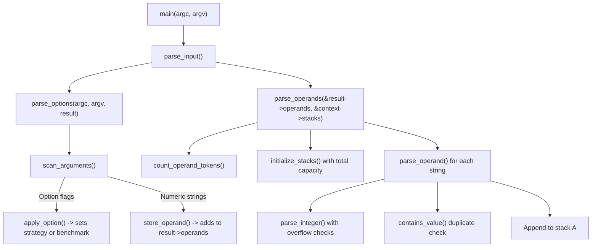

# Command-Line Parsing & Options System (`src/parsing/`)

This document details the command-line argument tokenizer, integer parser, duplicate detection, and CLI option parsing engine.

---

## 1. Overview of Parsing Flow

The parsing architecture cleanly separates **CLI options** (`-a`, `--adaptive`, `-b`, `--bench`, `-s`, `-m`, `-c`) from **operands** (the numbers to sort).



---

## 2. Options Parsing Engine (`src/parsing/options/`)

### 2.1. Option Specifications (`options_internal.h` & `parse_options.c`)

```c
const t_option_spec option_specs[] = {
    {'a', "adaptive", OPTION_SET_STRATEGY, STRATEGY_ADAPTIVE},
    {'s', "simple",   OPTION_SET_STRATEGY, STRATEGY_SIMPLE},
    {'m', "medium",   OPTION_SET_STRATEGY, STRATEGY_MEDIUM},
    {'c', "complex",  OPTION_SET_STRATEGY, STRATEGY_COMPLEX},
    {'b', "bench",    OPTION_ENABLE_BENCHMARK, STRATEGY_ADAPTIVE}
};
```

### 2.2. `scan_arguments.c` - Classification & Dispatch

#### Argument Classification:
```c
static t_argument_kind classify_argument(const char *arg)
{
    if (arg[0] == '\0')
        return (ARGUMENT_OPERAND);
    if (ft_strcmp(arg, "--") == 0)
        return (ARGUMENT_END_OPTIONS);
    if (arg[0] != '-' || arg[1] == '\0')
        return (ARGUMENT_OPERAND);
    if (arg[1] == '-')
        return (ARGUMENT_LONG_OPTION);
    if (ft_isdigit((unsigned char)arg[1]))
        return (ARGUMENT_OPERAND);
    if (ft_isalpha((unsigned char)arg[1]))
        return (ARGUMENT_SHORT_OPTION);
    return (ARGUMENT_INVALID);
}
```

#### Detailed Logic:
1. `""` (empty string) $\to$ treated as an operand (handled by operand parser, which fails with error as required by 42 subject).
2. `"--"` $\to$ standard POSIX end-of-options delimiter. All following arguments are treated as numeric operands, even if starting with `-`.
3. If does not start with `-` or is just `"-"` $\to$ `ARGUMENT_OPERAND`.
4. If starts with `"--"` $\to$ `ARGUMENT_LONG_OPTION`.
5. If starts with `'-'` followed by a digit (`-42`) $\to$ `ARGUMENT_OPERAND` (negative number!).
6. If starts with `'-'` followed by an alphabetic character (`-b`, `-s`) $\to$ `ARGUMENT_SHORT_OPTION`.
7. Anything else $\to$ `ARGUMENT_INVALID` (triggers error return).

#### `scan_arguments(t_parse_context *ctx)`:
Iterates through all arguments starting at index 1:
- If options are enabled and encounters `ARGUMENT_END_OPTIONS`, disables `options_enabled` and moves forward.
- If short options: handles clustered flags (e.g., `-ba` is parsed character by character in `parse_short_options.c`).
- If long option: matches exact string in `parse_long_option.c`.
- If operand: stores pointer in `context->result->operands.values[]`.

### 2.3. Conflict Prevention (`apply_option.c`)

```c
static int set_strategy(t_parse_result *result, t_strategy strategy)
{
    if (result->options.strategy_explicit
        && result->options.strategy != strategy)
        return (-1);
    result->options.strategy = strategy;
    result->options.strategy_explicit = true;
    return (0);
}
```
If conflicting strategy flags are supplied (e.g., `-s -m`), the parser rejects the input immediately with an error.

---

## 3. Operands Parsing Engine (`src/parsing/operands/`)

### 3.1. Counting Tokens (`count_operand_tokens.c`)

```c
static size_t count_argument_tokens(const char *arg)
{
    size_t count = 0;
    while (*arg)
    {
        while (*arg && ft_isspace(*arg))
            ++arg;
        if (*arg)
        {
            ++count;
            while (*arg && !ft_isspace(*arg))
                ++arg;
        }
    }
    return (count);
}
```
Iterates through each argument string, skipping spaces and counting space-delimited words.
This enables handling both multiple arguments (`./push_swap 3 2 1`) and quoted strings (`./push_swap "3 2 1"`).

`count_operand_tokens(const t_operands *operands)` sums the tokens across all operand strings to determine the exact `capacity` needed.

---

### 3.2. Integer Parsing & Overflow Detection (`parse_integer.c`)

```c
static int parse_sign(const char **cursor)
{
    int sign = 1;
    if (**cursor == '+' || **cursor == '-')
    {
        if (**cursor == '-')
            sign = -1;
        ++(*cursor);
    }
    return (sign);
}

static int parse_magnitude(const char **cursor, unsigned long limit,
        unsigned long *magnitude)
{
    unsigned long digit;

    *magnitude = 0;
    while (ft_isdigit((unsigned char)**cursor))
    {
        digit = (unsigned long)(**cursor - '0');
        if (*magnitude > (limit - digit) / 10UL)
            return (-1);
        *magnitude = *magnitude * 10UL + digit;
        ++(*cursor);
    }
    return (0);
}

int parse_integer(const char **cursor, int *value)
{
    unsigned long magnitude;
    unsigned long limit;
    int sign;

    sign = parse_sign(cursor);
    if (!ft_isdigit((unsigned char)**cursor))
        return (-1);
    limit = (unsigned long)INT_MAX;
    if (sign < 0)
        limit = (unsigned long)(-(INT_MIN + 1)) + 1UL;
    if (parse_magnitude(cursor, limit, &magnitude) != 0)
        return (-1);
    if (**cursor && !ft_isspace((unsigned char)**cursor))
        return (-1);
    if (sign < 0 && magnitude == limit)
        *value = INT_MIN;
    else if (sign < 0)
        *value = -(int)magnitude;
    else
        *value = (int)magnitude;
    return (0);
}
```

#### Line Details & Defensive Techniques:
1. **Sign Handling**: `parse_sign` parses at most one `+` or `-`. If followed by another sign (e.g. `++1`), `parse_integer` will see that the next char is not a digit and return `-1`.
2. **Explicit Bounds**:
   - `INT_MAX = 2147483647`
   - For negative numbers, `INT_MIN = -2147483648`.
   - `limit` is computed using `(unsigned long)(-(INT_MIN + 1)) + 1UL` to avoid undefined behavior of negating `INT_MIN` directly in signed integers.
3. **Overflow Check Formula**:
   `*magnitude > (limit - digit) / 10UL`
   Before updating `*magnitude * 10 + digit`, this algebraic inverse checks if the operation would exceed `limit`. This prevents C undefined integer overflow behavior entirely.
4. **Trailing Garbage Check**:
   `if (**cursor && !ft_isspace((unsigned char)**cursor)) return (-1);`
   Ensures tokens like `42abc` or `123_` are rejected.

---

### 3.3. Duplicate Value Checking & Stack Storage (`parse_operand.c`)

```c
static bool contains_value(const t_stack *stack, int value)
{
    size_t i = 0;
    while (i < stack->size)
    {
        if (stack->data[i] == value)
            return (true);
        ++i;
    }
    return (false);
}

int parse_operand(const char *arg, t_stack *stack)
{
    size_t initial_size = stack->size;
    int value;

    while (*arg && ft_isspace((unsigned char)*arg))
        ++arg;
    while (*arg)
    {
        if (parse_integer(&arg, &value) != 0)
            return (-1);
        if (contains_value(stack, value))
            return (-1);
        stack->data[stack->size] = value;
        ++stack->size;
        while (*arg && ft_isspace((unsigned char)*arg))
            ++arg;
    }
    if (stack->size == initial_size)
        return (-1);
    return (0);
}
```

#### Key Safeguards:
- **`contains_value(stack, value)`**: Scans already parsed elements in stack A. If `value` is already present, returns `-1` (duplicate error).
- **`stack->data[stack->size] = value; ++stack->size;`**: Inserts directly into stack A without overhead.
- **Empty / whitespace-only string check**: If `stack->size == initial_size` (e.g., input was `""` or `"   "`), returns `-1`, triggering `"Error\n"`.

---

### 3.4. Putting It Together (`parse_operands.c`)

```c
int parse_operands(const t_operands *operands, t_stacks *stacks)
{
    size_t i;
    size_t total;

    total = count_operand_tokens(operands);
    if (total == 0 || initialize_stacks(stacks, total) != 0)
        return (-1);
    i = 0;
    while (i < operands->count)
    {
        if (parse_operand(operands->values[i], &stacks->a) != 0)
        {
            destroy_stacks(stacks);
            return (-1);
        }
        ++i;
    }
    return (0);
}
```
If any error occurs, `destroy_stacks(stacks)` is called immediately, leaving zero leaked memory.
