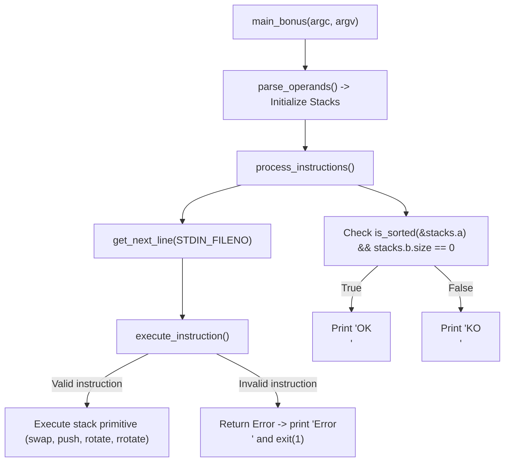

# Checker Bonus Program (`src/bonus/`)

This document explains the bonus `checker` program that validates whether a list of push_swap operations correctly sorts stack A without leaving any elements in stack B.

---

## 1. Architecture of `checker`

The bonus program is compiled as a separate binary (`checker`) via `make bonus`.



---

## 2. Line-by-Line Breakdown: `src/bonus/`

### 2.1. `main_bonus.c`

```c
int main(int argc, char **argv)
{
    t_operands  operands;
    t_stacks    stacks;

    if (argc == 1)
        return (0);
    operands.count = argc - 1;
    operands.capacity = argc - 1;
    operands.values = argv + 1;
    if (parse_operands(&operands, &stacks) != 0)
    {
        ft_dprintf(STDERR_FILENO, "Error\n");
        return (1);
    }
    if (process_instructions(&stacks) != 0)
    {
        destroy_stacks(&stacks);
        ft_dprintf(STDERR_FILENO, "Error\n");
        return (1);
    }
    if (is_sorted(&stacks.a) && stacks.b.size == 0)
        ft_printf("OK\n");
    else
        ft_printf("KO\n");
    destroy_stacks(&stacks);
    return (0);
}
```

#### Line Details:
1. `if (argc == 1) return (0);`: If no numbers are passed, exits silently.
2. Constructs `t_operands` directly pointing to `argv + 1`.
3. Calls `parse_operands()`: Allocates stacks and fills stack A.
4. Calls `process_instructions(&stacks)`: Reads lines from standard input (`stdin`).
5. Evaluates success:
   - `is_sorted(&stacks.a)`: Stack A must be sorted in ascending order.
   - `stacks.b.size == 0`: Stack B must be completely empty!
   - Prints `"OK\n"` if both conditions hold; otherwise prints `"KO\n"`.
6. Calls `destroy_stacks(&stacks)` to free all heap buffers before exit.

---

### 2.2. Instruction Loop (`checker_loop_bonus.c`)

```c
int process_instructions(t_stacks *stacks)
{
    char    *line;

    line = get_next_line(STDIN_FILENO);
    while (line)
    {
        if (execute_instruction(stacks, line) != 0)
        {
            free(line);
            get_next_line_cleanup();
            return (-1);
        }
        free(line);
        line = get_next_line(STDIN_FILENO);
    }
    if (get_next_line_has_error())
        return (-1);
    return (0);
}
```

#### Memory Safety & GNL:
- Reads instructions line-by-line using `get_next_line(STDIN_FILENO)`.
- If an instruction is invalid:
  - Immediately frees `line`.
  - Calls `get_next_line_cleanup()` to clear any static buffers inside GNL.
  - Returns `-1`, causing `main_bonus` to print `"Error\n"`.
- If an I/O error occurred during reading: `get_next_line_has_error()` detects it and returns `-1`.

---

### 2.3. Dispatch Engine (`checker_dispatch_bonus.c`)

```c
int execute_instruction(t_stacks *stacks, char *line)
{
    size_t length;

    length = ft_strlen(line);
    if (length > 0 && line[length - 1] == '\n')
        line[length - 1] = '\0';
    if (line[0] == 's')
        return (execute_swap(stacks, line));
    if (line[0] == 'p')
        return (execute_push(stacks, line));
    if (line[0] == 'r' && line[1] == 'r' && line[2] != '\0')
        return (execute_reverse_rotate(stacks, line));
    if (line[0] == 'r')
        return (execute_rotate(stacks, line));
    return (-1);
}
```

#### Matching Logic:
- Trims trailing newline `\n`.
- Efficient first-character branch:
  - `'s'` $\to$ `execute_swap` (`sa`, `sb`, `ss`).
  - `'p'` $\to$ `execute_push` (`pa`, `pb`).
  - `'r'` with second char `'r'` and non-empty third char $\to$ `execute_reverse_rotate` (`rra`, `rrb`, `rrr`).
  - `'r'` $\to$ `execute_rotate` (`ra`, `rb`, `rr`).
  - Any other string returns `-1` (invalid instruction).

---

### 2.4. Primitive Executors

Unlike `push_swap` operations, the checker executors **do not print** instruction names or record stats. They directly invoke the stack primitives:

#### Push (`execute_push_bonus.c`):
```c
static int transfer_top(t_stack *src, t_stack *dst)
{
    int value;

    if (stack_pop_top(src, &value) == STACK_UNCHANGED)
        return (0);
    stack_push_top(dst, value);
    return (0);
}

int execute_push(t_stacks *stacks, const char *line)
{
    if (ft_strcmp(line, "pa") == 0)
        return (transfer_top(&stacks->b, &stacks->a));
    if (ft_strcmp(line, "pb") == 0)
        return (transfer_top(&stacks->a, &stacks->b));
    return (-1);
}
```
*Note*: If a stack is empty when `pa` or `pb` is executed, the 42 subject specifies that the operation does nothing (it does not crash or error). `transfer_top` gracefully does nothing if `stack_pop_top` returns `STACK_UNCHANGED`.

#### Swap (`execute_swap_bonus.c`):
- `"sa"`: `stack_swap_top(&stacks->a)`
- `"sb"`: `stack_swap_top(&stacks->b)`
- `"ss"`: `stack_swap_top(&stacks->a); stack_swap_top(&stacks->b);`

#### Rotate (`execute_rotate_bonus.c`):
- `"ra"`: `stack_rotate(&stacks->a)`
- `"rb"`: `stack_rotate(&stacks->b)`
- `"rr"`: `stack_rotate(&stacks->a); stack_rotate(&stacks->b);`

#### Reverse Rotate (`execute_reverse_rotate_bonus.c`):
- `"rra"`: `stack_reverse_rotate(&stacks->a)`
- `"rrb"`: `stack_reverse_rotate(&stacks->b)`
- `"rrr"`: `stack_reverse_rotate(&stacks->a); stack_reverse_rotate(&stacks->b);`
